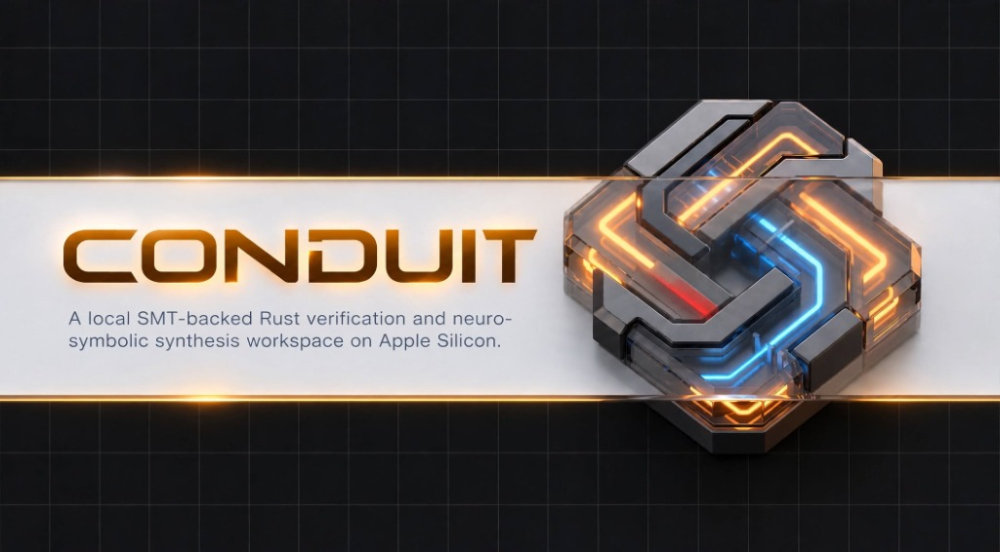

# CONDUIT Lab: a browser engine we can prove, one component at a time

Of the last 20 Chrome bugs that Google confirmed were exploited in the wild, 13 were in V8.
Most are type confusion or out-of-bounds access, where the JavaScript engine assumed something
about an object's layout that an attacker could make false. This repository is building a browser
in which the security-critical code is checked against its published standard by a theorem prover.
Every unproved line is counted as trusted, and that count is ratcheted so it never rises between
releases.

The tool is [Verus](https://github.com/verus-lang/verus). You write Rust plus a specification,
also in Rust, and Verus asks the Z3 solver whether any input breaks the specification. A "no"
from Z3 means the claim holds for every input. A "yes" comes with the input that breaks it.

## What exists today

The `browser/` workspace contains 11 verified Rust crates (`#![forbid(unsafe_code)]`, zero `assume`,
`admit`, `external_body`, or `unsafe`), backed by WPT, `tc39/test262`, `WebAssembly/spec`, and
randomized differential tests:

| Crate | Step | Scope | Proved |
|---|---|---|---|
| `vurl` (`browser/url`) | Phase 1 | WHATWG URL Standard (`4f461b81`): `percent`, `ipv4`, `ipv6` | `exec == spec`, percent roundtrip, shortest IPv6 hex |
| `vjs_spec` (`browser/vjs-spec`) | J0 | ESMeta `<emu-alg>` → Verus compiler (25 ECMA-262 clauses) | `exec == spec` across generated spec steps |
| `vjs_types` (`browser/vjs-types`) | J1 | UTF-16, IEEE-754 `JsNumber`, `JsBigInt`, `ToPrimitive`, equality | Burger-Dybvig `Number::toString`, RNE `StringToNumber`, `ToInt32`/`ToUint32` |
| `vjs_object` (`browser/vjs-object`) | J2 | Arena heap, property descriptors, ordinary & Array exotic objects | `Heap::wf` + ECMA-262 §6.1.7.3 Essential Internal Method Invariants |
| `vjs_syntax` (`browser/vjs-syntax`) | J3 | UTF-8/UTF-16 lexer (ASI + `<USP>`), Pratt/RD parser, Early Errors | Total panic-free lex/parse (`decreases`) + `Program::wf` |
| `vjs` (`browser/vjs`) | J4 | ECMAScript interpreter core, closures, completion records, realm quotas | End-to-end step refinement, fuel exactness, cross-realm isolation |
| `vjs_webidl` (`browser/vjs-webidl`) | J4b | WHATWG Web IDL `ToJS`/`ToIDL` boundary & generational `KernelCapTable` | `USVString` idempotence, no-use-after-revoke, cross-origin non-interference |
| `vjs_builtins` (`browser/vjs-builtins`) | J5 | JSON, Warblre RegExp, §21.4 Date, Math, Array, String, Map, Set | Vest JSON roundtrip/prefix security & terminating RegExp matcher |
| `vjs_gc` (`browser/vjs-gc`) | J6 | Tricolor Mark-Sweep GC, Proxy/Reflect, Promise job queue, Generators | Reachable preservation, Proxy §6.1.7.3, FIFO `drain_jobs` liveness |
| `vjs_vm` (`browser/vjs-vm`) | J7 | Bytecode compiler & stack VM with frame recycling | CompCert-style simulation: `spec_run_vm(compile(p)) == spec_eval(p)` |
| `vwasm` (`browser/vwasm`) | J7 | WebAssembly 1.0 binary decoder & sandboxed linear-memory interpreter | LEB128 prefix/roundtrip + `theorem_wasm_invoke_sandbox_containment` |

Live counts (verified functions, trusted items, verification seconds, crate tests, conformance pass
rates, and J7 bytecode VM speedups) are recorded in [`browser/ratchet.json`](browser/ratchet.json)
by `browser/scripts/ratchet.py`.


## What is still design


[`docs/verified-browser-engine.md`](docs/verified-browser-engine.md) is the overall architecture.
It is modeled on Verdict (a verified X.509 validator in Verus) and Quark (a 2012 browser whose
kernel was proved in Coq while unmodified WebKit ran untrusted in sandboxed tabs). A kernel
written in Verus owns the network parsers, origin and cookie policy, tabs, and the address bar.
Renderers run one per site in a sandbox and can only act through typed IPC.
[`docs/vjs-plan-review.md`](docs/vjs-plan-review.md) maps the 20 Chrome CVEs above onto that
design and lists its tradeoffs.

While `vurl` and the J0–J7 `vjs` + `vwasm` crates are implemented and verified, the browser kernel
theorems, Nanvix renderer isolation, HTML/CSS layout (`html5ever`/Stylo integration), and full
browser UI remain design/next phases. `vurl` also does not yet cover validation errors, opaque or
domain hosts, IDNA, or the full URL parser state machine.

## The site

The GitHub Pages site (`site/`, React 19 on
[`@maceip/ix-workbench-primitives`](https://github.com/maceip/ix-workbench-primitives), Siemens iX v5)
tells the same story in five sections: the exploited CVEs and the answer to each, what a Verus
proof checks (shown on real `vurl` code), why nobody proves a whole browser or a whole Linux, the
kernel-and-renderers design, and live 11-crate status. It reads every number at load time from
`browser/ratchet.json` and `data/stats.json`. If either file is missing, it shows an error and
`not recorded`. Playwright checks the rendered page against both files.

### Build

The primitives are used from source because the package is not on npm. Clone them next to this
repo. `site/vite.config.ts` also accepts a checkout inside the repo, which is what CI uses.

```sh
git clone https://github.com/maceip/ix-workbench-primitives ../ix-workbench-primitives
npm --prefix site install
npm run build          # vite build -> dist/, then stages data/, ratchet, assets/, irrigation demo
```

### Regenerate the data

```sh
source ~/workspaces/verus-stack/env.zsh
./browser/scripts/use-local-verus.sh
python3 scripts/collect_stats.py               # add --with-mathlib to build mathlib benchmarks too
(cd browser && python3 scripts/ratchet.py)     # re-verify all 11 crates, rewrite browser/ratchet.json
```

The collector re-verifies `vstd` into a temp dir (installed artifacts are untouched) along with
the Verus examples, builds each Vero Lean benchmark, runs the browser ratchet, records toolchain
versions and repo commits, and saves raw command output to `data/logs/`. Commit `data/` and
`browser/ratchet.json` after each run.

### Test

```sh
npm install
npx playwright test tests/site.spec.js         # builds or tests dist/ against ratchet.json + stats.json
source ~/workspaces/verus-stack/env.zsh
./browser/scripts/use-local-verus.sh
(cd browser && cargo test -p vjs --test full_pipeline_j0_j7)
```

The irrigation tests also start a real local bridge on port 8797 and need the verus-stack
toolchain. Set `NANVIX_HOST` to exercise the Nanvix guest too.

### Local preview

```sh
npm run build
python3 -m http.server 8000 --directory dist   # open http://localhost:8000
```

### Deployment

On push to `main`, `.github/workflows/pages.yml` checks out this repo and
`maceip/ix-workbench-primitives`, builds `site/` with Node 20, and uploads `dist/` to GitHub Pages.
Design-system changes only reach the deployed site after they are pushed to
`maceip/ix-workbench-primitives`.

## Irrigation console

`irrigation.html` is a standalone page that the build copies into `dist/`. It is a garden
irrigation console whose valve decisions come from `controller/ctl.rs`, a Verus-verified controller
(pump capacity, maximum run time, and a tank that never underflows). The same file runs in two
places: on macOS, built by the bridge with the verus-stack toolchain, and as a Nanvix guest
(`controller/nanvix-guest`, branch `conduit-irrigation` of maceip/nanvix) on a Windows 11 machine
with WHP, driven over SSH.

```sh
python3 bridge/conduit_bridge.py --nanvix-host user@windows-host   # settings saved to ~/.conduit-lab/
```

Open the page locally or on GitHub Pages and allow Chrome's local-network prompt. Soil moisture is
simulated. Valve state, tank level and delivered water are the controller's real replies.
